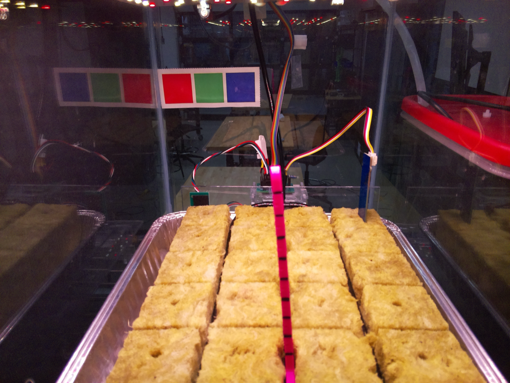
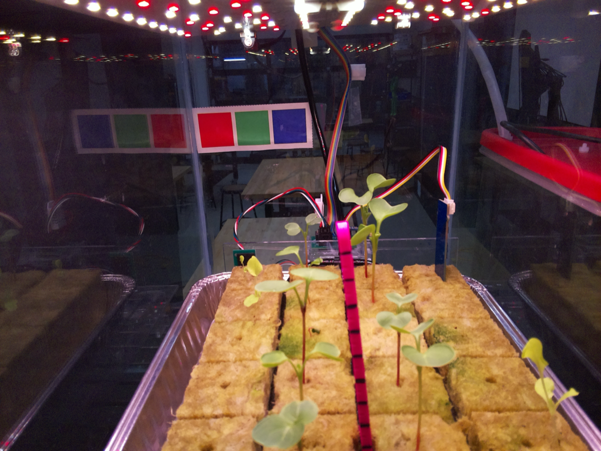
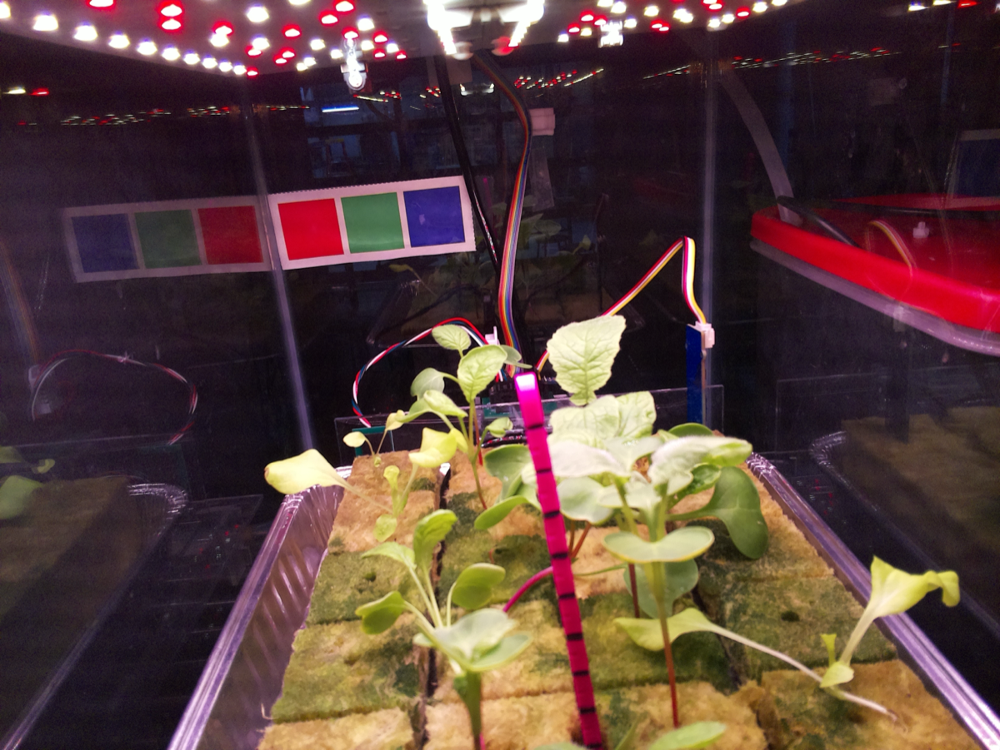
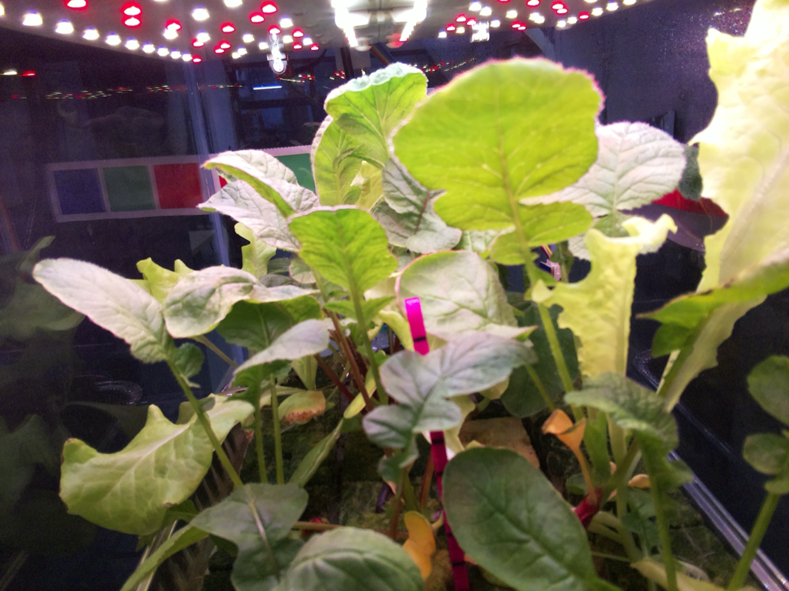
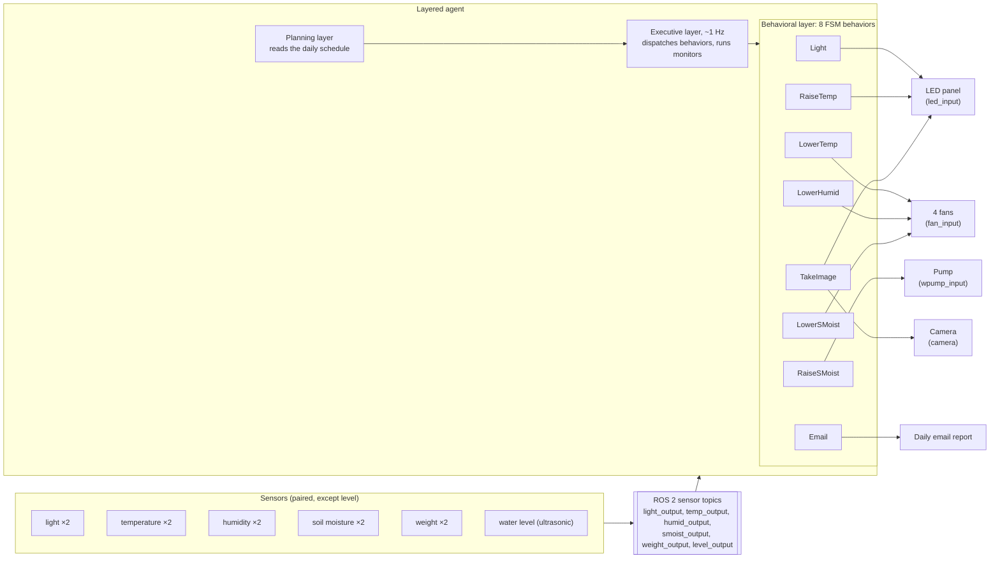
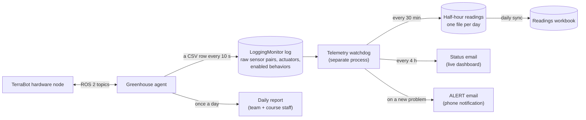
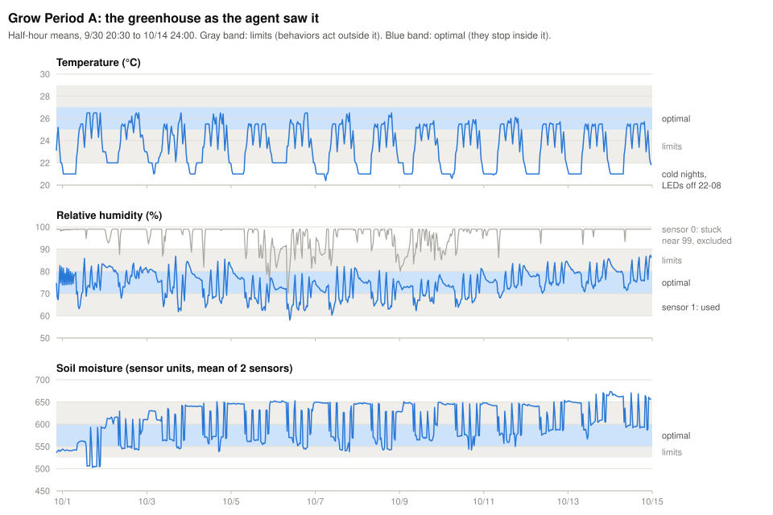
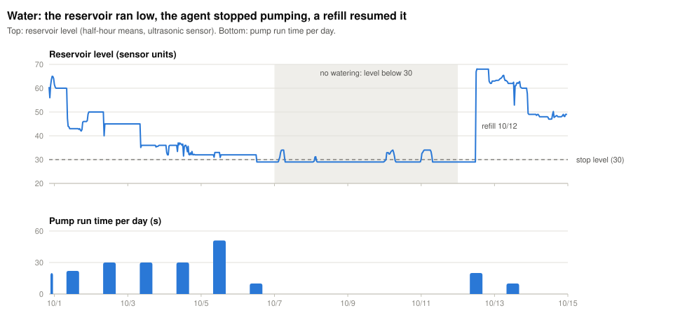

# TerraBot: an autonomous greenhouse agent

The TerraBot is a small robotic greenhouse: a 10-gallon glass tank run by a Raspberry Pi and an Arduino. It senses with paired light, temperature, humidity, soil-moisture and weight sensors plus an ultrasonic water-level sensor, and it acts through an LED light panel, four fans (one in each corner), a water pump fed from a water-and-nutrient reservoir, and a color camera. Radish and lettuce grow in rockwool in front of a pink measuring stick and a color-calibration card. For Grow Period A (September 30 to October 14, 2026), our agent had to keep those plants alive on its own for two weeks. It ran for **14.15 days with the agent logging 99.6% of the time**. Humidity stayed within its limits **99.7%** of the time, soil moisture **89.5%** and temperature **74.1%**. All of the temperature misses were cold nights, when the LEDs (the only heat source) have to be off.

> **About this write-up.** This was a team project in CMU 15-482 *Autonomous Agents* (Fall 2026). The course is still running, and the agent was built on the instructor's private TerraBot platform. So this repository has **no course or homework code**, handouts or grader files. It describes the design in prose, diagrams and tables, and it reports results computed from our own telemetry. **The code is private under course policy and available on request.**
>
> **My share:** the test suite and the logging monitor; the Grow A deployment, telemetry and alerting tooling; the fixes we made during the grow; and the color-correction stage of the vision pipeline.

| Day 0 (9/30) | Day 9 (10/9) | Day 14, end of Grow A (10/14) | Day 28, same agent (10/28) |
|---|---|---|---|
|  |  |  |  |

*The agent took every photo itself, at a scheduled time, after bringing the light into a fixed range with the LEDs.*

---

## Contents
- [Architecture](#architecture)
- [Behaviors](#behaviors)
- [Monitoring and self-checks](#monitoring-and-self-checks)
- [Perception](#perception)
- [Testing and deployment](#testing-and-deployment)
- [Results](#results)
- [Lessons learned](#lessons-learned)

---

## Architecture

The robot's hardware is wrapped in ROS 2. The Arduino interface publishes each sensor pair on its own topic and subscribes to one command topic per actuator. A simulator ("fake Arduino") publishes the same topics, so **the same agent code runs in simulation and on the robot**.



We used the course's **layered architecture**, in the spirit of 3T: planning, then executive, then behavioral.

- **Planning layer.** It loads the day's schedule and reloads it at midnight. The schedule is a list of time windows per behavior (for example, watering at 08:30, 12:30, 16:30 and 20:30). The schedule is also where resource conflicts get resolved: behaviors don't arbitrate among themselves at run time. The fan is shared by three behaviors and the LEDs by three, so behaviors that share an actuator get separate windows. One overlap remained: the 20:40 photo falls inside the 20:00–21:00 heating window.
- **Executive layer.** Once a second it compares the clock to the schedule. It disables behaviors whose windows have ended *before* it enables new ones, so a behavior that is finishing releases its actuator before the next one takes it. It also runs the **monitors**, which watch the system and can retune behaviors but never actuate.
- **Behavioral layer.** Each behavior is a **finite-state machine built with `pytransitions`**. On every step it *perceives* (copies the sensor values it needs) and then *acts* (fires a step trigger, and the FSM picks the first transition whose conditions hold). The course rules we followed:
  - Conditions only test. Actions live in transition callbacks.
  - Every behavior has a `Halt` state. **On disable, a behavior turns off whatever it turned on**, so it leaves the greenhouse safe whenever the executive stops it.
  - Behaviors start acting when a reading leaves its **limits** and stop only once it reaches the narrower **optimal** band. The gap between the two is a dead zone (hysteresis), which keeps actuators from chattering on and off.

The general pattern, as pseudocode:

```text
state Watering:
    on enter:            pump on;  deadline = now + 10 s
    when now >= deadline: pump off; go to Measuring    # timed transition
state Measuring:
    on enter:            deadline = now + 5 min         # let the water soak in
    when now >= deadline: add measured weight gain to today's total; go to Waiting
from any state:
    on disable:          pump off; go to Halt           # always leave the system safe
```

---

## Behaviors

Ranges in force during Grow A. Limits are half-open `[lo, hi)` and optimal bands are closed:

| | Limits | Optimal |
|---|---|---|
| Temperature | 22–29 °C | 25–27 °C |
| Humidity | 60–90 % | 70–80 % |
| Soil moisture (sensor units) | 525–650 | 550–600 |
| Light (sensor units) | 850–950 by default; LightMonitor retargets it daily | |

| Behavior | Goal | Trigger / schedule | Safety limits |
|---|---|---|---|
| **Light** | Keep the combined ambient and LED light in the target band during the day | 4 windows: 09–12, 13–16, 17–20, 21–22. Steps the LEDs ±20 toward the band | LEDs forced off 22:00–08:00. Level clamped to 0–255. LEDs off on disable. The band (set by LightMonitor) is wider than one LED step, so the LEDs don't oscillate |
| **RaiseTemp** | Keep temperature above the lower limit, using the LEDs as the heater | 08:00, 12:00, 16:00 (30 min each) and 20:00–21:00. Turns on at ≤ 22 °C, off at ≥ 25 °C | Only runs inside daytime windows (LEDs must be off at night). LEDs off on disable |
| **LowerTemp** | Keep temperature below the upper limit | 09:30, 13:30, 17:30, 21:30 (30 min each). Fan on at ≥ 29 °C, off at ≤ 27 °C | Fan off on disable |
| **LowerHumid** | Keep humidity below the upper limit | First half of every hour (24 windows). Fan on at ≥ 90 %, off at ≤ 80 % | Fan off on disable. From 10/1 it used **only humidity sensor 1** (sensor 0 was stuck near 99) |
| **RaiseSMoist** (watering) | Keep the rockwool watered without drowning the roots | 08:30, 12:30, 16:30, 20:30 (30 min each). A pulse–soak–measure loop: 10 s pump pulse, 5 min soak, then measure the weight gain (4-sample sliding window) | **100 g/day cap**, saved to disk so a restart can't grant a second allowance. **No pumping when the reservoir reads below 30.** Stops early once soil reaches the wet limit. Pump off on disable |
| **LowerSMoist** | Dry over-wet soil with airflow | 10:30, 14:30, 18:30 (30 min each). Fan on at ≥ 650, off at ≤ 600 | Fan off on disable |
| **TakeImage** | 3 well-exposed photos a day | 08:40, 12:40, 16:40, 20:40 windows. Adjusts the LEDs until the light reads 400–600, waits for the sensor to settle, photographs, checks that the file exists | **At most 3 photos per calendar day.** Never shoots outside the light range. Up to 3 retries. LEDs off on disable |
| **Email** | Daily report to the team and course staff | 13:15 | Real sends need an explicit deploy flag. Every test run, in sim or on hardware, only prints. A failed send can't crash the agent |

---

## Monitoring and self-checks

Monitoring runs at three levels: **inside the agent** (executive-layer monitors), **inside the behaviors** (guards on every risky action), and **outside the agent** (a separate watchdog process). The watchdog is separate so that a bug in it can never take the greenhouse down.



| Check | Where | What it catches |
|---|---|---|
| **LightMonitor** (insolation budget) | Executive | Adds up the day's light. Using a recorded ambient-light profile and the remaining light windows, it works out how bright the Light behavior must be to reach the daily target (8,500 light-units × hours), then retargets that behavior's band. Catches days that would come up short, early enough to make up for them |
| **LoggingMonitor** | Executive | Writes one row every 10 s: both raw sensors of each pair, the actuator states, and which behaviors are enabled (so you can see *why* an actuator changed). Flushed every row, because a 2-week agent can be killed at any moment |
| Reservoir guard | RaiseSMoist | Never pumps a dry tank (level < 30) |
| Persistent daily water cap | RaiseSMoist | A crash or redeploy can't double-water the plants |
| Settle detection and file check | TakeImage | Stale light readings after an LED change, and failed captures (retried) |
| **Agent / hardware node down, log stale > 10 min** | Watchdog | Crashes and hangs: a running agent whose log stopped moving |
| **Tank low / tank empty** | Watchdog | A reservoir near or below the level where watering stops |
| **Soil dry for 1 h; temperature > 2 °C outside its limits for 1 h; humidity > 95 % for 2 h** | Watchdog | Sustained environmental failures. The time windows keep one noisy reading from paging anyone |
| **Pump on > 60 s straight** | Watchdog | A stuck pump. Watering only uses 10 s pulses |
| **No photo for 26 h, disk nearly full, Pi rebooted** (the reboot alert came after Grow A) | Watchdog | Silent failures of the camera, storage and power |
| Alert rate limits | Watchdog | Each alert repeats at most every 12 h, with at most 4 alert emails a day. Learned the hard way (see Results) |

To be candid about timing: I wrote the alerting on day 4 of the grow, after the email outage described below. The robot kept running the older, status-only telemetry until at least 10/10, so for most of Grow A we watched it through hourly status emails and the daily report, not alerts.

**Sensor sanity by cross-checking redundant sensors.** Most sensors come in pairs, and comparing the pair is the cheapest diagnostic there is. Our 48-hour pre-deployment hardware run, logged by the LoggingMonitor, showed humidity sensor 0 pinned near 99 %. **Every one of the 8 fan runs in that test was a false alarm.** During Grow A, sensor 0 read 95 % or more for 78% of the time, so from 10/1 the agent used sensor 1 alone. In class we also built a **symbolic, model-based diagnoser**: the greenhouse hardware written as propositional logic and solved with a SAT solver to find which components could be faulty, checking single faults before multiple ones. That was a homework exercise and was not part of the deployed agent.

---

## Perception

During Grow A the camera only *captured* photos. They went out in the daily email and were kept for analysis. The vision pipeline was built afterwards as a team homework on course-provided TerraBot images, and is being wired into the Grow B daily report. Design:

- **Per-pixel classifiers** (scikit-learn), trained on hand-labeled masks, for three things: foliage, the pink measuring stick, and the color-calibration card.
  - **Lighting robustness:** each image is **standardized per image** in LAB color space (subtract its mean, divide by its standard deviation). For foliage that raised accuracy from 86% to 89.5%. For the card, together with new color-contrast features, it went from 85% to 95%.
  - **Mask cleanup with hysteresis thresholding:** high-confidence pixels seed a region, and lower-confidence pixels connected to it are added. It is the same dead-zone idea the behaviors use, applied to masks.
- **Plant height.** The stick has a tick mark every centimeter, from 0 cm (the rockwool surface) to 9 cm. The pipeline finds the ticks, then reports the highest tick that foliage covers. A single 2D camera can't measure depth, so this measures the tallest plant in front of the stick.
- **Color correction** (my part). The pipeline finds the calibration card, then fits an **affine transform in LAB by least squares** that maps the card's colors in the current image to a reference image, and applies it to the whole frame.
  - **Finding the card:** a random forest on standardized LAB, HSV and neighborhood features. Its strongest cue is local color contrast, since nowhere else in the frame do vivid red, green and blue patches touch. Its mask is cleaned with hysteresis and blob logic that rejects the card's reflection on the side wall. It scores **99.5% mean leave-one-image-out balanced accuracy** (up from 84.8% with raw LAB) and 99.2–99.8% on the held-out test images.
  - **Correcting colors:** the error over the card drops by **77.9% on average**.
- **Plant health.** It combines the change in foliage area and height over time into a health estimate for the daily email.

---

## Testing and deployment

**Simulation first.** The simulator mimics the greenhouse's dynamics: similar to the real thing, but not identical. It runs at up to 100× real time, so a simulated day takes about a quarter of an hour. Every test starts from a **baseline**, a scripted starting state (time of day, temperature, humidity, soil moisture, reservoir level and so on). It then checks temporal properties of two kinds, as the course teaches:

- **Liveness:** whenever a bad condition starts, the greenhouse gets back to a good state within some time.
- **Safety:** a bad thing never happens.

| Test | Kind | Property (paraphrased) |
|---|---|---|
| Lights day/night | Both | LEDs come on when it's dark in a light window, and are never on at night |
| Light in range | Liveness | Light settles within 15 min of a window opening, then holds steady and never overshoots |
| Dry soil → pump | Liveness | The pump starts within 90 s of the window opening, runs only in short pulses, and soil recovers above the limit |
| No overwatering | Safety | Wet soil is never watered, and the pump is only ever on under the watering behavior |
| Low reservoir | Safety | No pumping below the stop level |
| Hot → fan; cold → LEDs; humid → fan | Liveness | Each starts in time *and* stops only after reaching optimal |
| Restart mid-day | Safety | An agent restart never waters twice in one day |
| Stuck humidity sensor (fault injected) | Both | Fan runs for real humidity, not for the stuck sensor |
| 3 simulated days of photos | Liveness | 3 photos every day, not just the first two |

All 8 pre-deployment property tests passed. Two practices made the suite trustworthy:

- **Each new regression test was run against the old, buggy code to prove it fails there.** This is a seeded-fault check on the test itself.
- **Tests respect the dead zone.** Our first drafts checked "actuator on OR value in the optimal band". They reported false failures when a correctly stopped actuator let the reading drift back into the dead zone. The fix was to test "turns on within N s of crossing the limit" and "turns off only after reaching optimal" separately.

The tests also caught real bugs before deployment:

- **The LEDs flip-flopped all day.** LightMonitor's target band was narrower than one LED step, so the controller could never land in it. We widened the band to 80 units.
- **A 12:40 photo came out overexposed.** The camera behavior checked the light before the sensor had registered the LED change.

**Then hardware.** Before the grow, a 48-hour run on the real robot was logged and plotted next to a 24-hour simulated run. It showed two things the simulator can't:

- the stuck humidity sensor;
- aging soil-moisture sensors that read higher than expected (520–540 on watered rockwool). Based on that log, we raised the moisture lower limit from 500 to 525 for the grow.

**Preparing the hands-off deployment:**
- **Process supervision.** The hardware node, the agent and the telemetry watchdog each run in their own `tmux` pane on the Pi, so they survive logout. After a power cut in November we added an `@reboot` autostart, plus an alert that fires when the Pi has rebooted.
- **Email is safe by default.** Only the deploy flag sends to course staff. A test run can never spam anyone.
- **Safe redeploys.** A script copies the new agent and restarts **only** the agent. It refuses to run during watering and email windows. Thanks to the persistent water cap, a restart can't double-water.
- **Observability.** The watchdog records half-hour readings into a workbook (one sheet per day) and sends a status email to a live dashboard. During Grow A that email went out hourly. The current version sends it every 4 hours and adds immediate, rate-limited alerts.
- **A grow journal.** Every incident got a timeline entry, a root cause and a fix. Every code bug also got a regression test.

---

## Results

All numbers below come from [`scripts/grow_a_metrics.py`](scripts/grow_a_metrics.py), a standard-library-only script that reads our half-hour readings workbook. Shares of time are weighted by how many minutes the agent was logging in each half hour, and they are computed on half-hour means. They agree with the team's own analysis (temperature 73.8% vs 74%, soil moisture 89.4% vs 90% over 10/1–10/14).

| Metric | Grow Period A (9/30 20:30 → 10/14 24:00) |
|---|---|
| Duration | **14.15 days** (14 full days) |
| Agent logging | **99.6%** of the window. Two gaps, both redeploys: 6 min on 10/1 and 9 min on 10/10 |
| Temperature within limits (22–29 °C) | **74.1%** (optimal 25–27 °C: 32.5%) |
| Humidity within limits (60–90 %, sensor 1) | **99.7%** (optimal 70–80 %: 59.0%) |
| Soil moisture within limits (525–650) | **89.5%** (optimal 550–600: 35.0%) |
| Daily light total | Mean **8,159** vs an 8,500 target. 8 of 14 days within 5% |
| Watering | 223 s of pumping on 9 days. **Paused 10/7–10/11 because the reservoir was below the stop level.** Resumed after a refill on 10/12 |
| Photos | **26.** 3 a day, except 10/3–10/8 (none, because of a counter bug) |
| Human interventions | **1 physical** (reservoir refill, 10/12). **2 agent restarts** for software fixes (10/1, 10/10). **1 email-account unlock** (10/4) |



**What the numbers say:**
- **Temperature.** It was never too hot: the maximum was 26.5 °C. Temperature was below 22 °C for 25.9% of the grow, and **100% of that cold time fell between 22:00 and 08:00**. Those are the hours when the LEDs, the only heat source, must stay off. The lowest reading was 20.4 °C. A reactive agent with this hardware can't fix cold nights. It is a limit of the hardware and the light schedule, not a missed trigger.
- **Humidity.** Switching to the trusted sensor ended the false alarms. The fan ran **11.7 minutes in the first 16 hours** and **0.9 minutes in the remaining 13.5 days**. Humidity peaked at 87.3 %, under the 90 % limit.
- **Soil moisture.** It was above 650 for 8.7% of the time, and 80% of that was at night. It was below 525 for only 1.8%. Going back through the data for this write-up, I found the cause of the night-time highs. **Soil sensor 0 reads 567 with the LEDs on and 707 with them off, while sensor 1 reads 566 and 563.** One of the two sensors the agent averages follows the light schedule, not the soil. The agent had no check for this.
- **Water.** The water budget assumed 100 g/day × 14 days ≈ the 1.5 L reservoir. In practice the level reached the stop threshold on 10/6, day 6. From then on the reservoir guard did what it was designed to do and **stopped watering for five days** until the tank was refilled.
  - During the pause, the averaged soil reading stayed between 538 and 651. The limits are 525–650, so as far as that reading showed, nothing was wrong.
  - The load cells told a different story: **the tray's mean weight fell from 1,486 g on 10/6 to 1,179 g on 10/11 (−307 g)**. The weight sensors saw the drying; the moisture sensors didn't.
  - The watering was safe, but the budget was wrong.
- **Light.** The LEDs were on about 11 h/day. The last five days fell 10–18% short of the light target. With the LEDs at full power, the light reading dropped from about 805 on 10/1 to 610–650 on 10/12–10/14. That is likely leaves shading the sensors as the plants grew, though I didn't verify it.



**Incidents, from the grow journal:**

| When | What happened | Fix |
|---|---|---|
| 9/30–10/1 | The stuck humidity sensor caused fan false alarms | Use sensor 1 only, plus fault-injection tests. Redeployed 10/1 |
| 10/1 | A redeploy would have reset the 100 g/day water cap (it was kept only in memory) | Save the day's total to disk. Restart test. Confirmed on the robot: no second watering |
| 10/1 → 10/4 | The email provider locked the robot's account after about 25 automated telemetry emails in a day. **Daily reports were missed on 10/2, 10/3 and the morning of 10/4.** The agent itself was unaffected | Account unlocked, and the next daily report explained the gap. Telemetry rewritten to send status every 4 h instead of hourly, with rate-limited alerts |
| 10/2 → 10/8 | Photos stopped. The 3-a-day counter reset by comparing times of day, and after day 2 it never reset again. A 48 h test was too short to show it | Count photos per calendar date. 3-day simulated test. 3 photos a day again from 10/9 |
| 10/10 | The redeploy script's process check matched its own SSH command, so it "saw" an agent that had already quit, and the new agent never started (9 min down) | Run each check in its own SSH call. Longer quit timeout |

<details>
<summary>Daily detail (from the same script)</summary>

| Date | LED h | Fan min | Pump s | Photos | Light total | Min level | Soil reading (min–max) | Mean weight (g) |
|---|---|---|---|---|---|---|---|---|
| 9/30 (from 20:30) | 1.5 | 1.3 | 20 | 1 | 1,298 | 56.0 | 536–542 | 1,197 |
| 10/1 | 11.8 | 10.4 | 22 | 4 | 9,772 | 42.0 | 503–594 | 1,284 |
| 10/2 | 11.5 | 0.0 | 30 | 3 | 8,904 | 40.0 | 542–629 | 1,379 |
| 10/3 | 10.0 | 0.0 | 30 | 0 | 8,352 | 35.1 | 545–643 | 1,442 |
| 10/4 | 10.5 | 0.2 | 30 | 0 | 7,710 | 31.5 | 539–651 | 1,472 |
| 10/5 | 10.5 | 0.0 | 51 | 0 | 8,532 | 30.9 | 554–651 | 1,489 |
| 10/6 | 10.5 | 0.0 | 10 | 0 | 8,709 | 29.0 | 544–653 | 1,486 |
| 10/7 | 10.5 | 0.0 | 0 | 0 | 8,341 | 29.0 | 538–650 | 1,449 |
| 10/8 | 10.5 | 0.0 | 0 | 0 | 8,906 | 29.0 | 542–649 | 1,383 |
| 10/9 | 11.5 | 0.0 | 0 | 3 | 8,477 | 29.0 | 563–651 | 1,317 |
| 10/10 | 11.3 | 0.0 | 0 | 3 | 7,585 | 29.0 | 542–649 | 1,250 |
| 10/11 | 11.5 | 0.2 | 0 | 3 | 7,681 | 29.0 | 550–648 | 1,179 |
| 10/12 | 11.5 | 0.0 | 20 | 3 | 6,979 | 29.0 | 576–654 | 1,167 |
| 10/13 | 11.5 | 0.5 | 10 | 3 | 6,999 | 49.0 | 567–671 | 1,346 |
| 10/14 | 11.5 | 0.0 | 0 | 3 | 7,281 | 47.0 | 587–674 | 1,439 |

</details>

**After Grow A.** The official window ended on 10/14, but the plants stayed in until harvest on 11/4, so we left the same agent running unchanged as a baseline. Over the next 13.7 days of synced data (10/15–10/28) it logged **99.7%** of the time with no gaps. Temperature was within its limits 80.6% of the time, soil moisture 94.1% and humidity 99.7%. It took 3 photos every full day, and the one refill that period (10/21) came as the level reached the stop threshold.

---

## Lessons learned

This was a team project. These are my takeaways.

- **Cross-check redundant sensors online, not only in post-mortems.** We found the stuck humidity sensor in pre-deployment logs, yet deployed on the averaged reading anyway and fixed it the next morning. I only found the LED-coupled soil sensor, and the drying that the weight sensors saw but the moisture sensors missed, while writing this up. One monitor could have caught all three: compare each sensor pair, check correlated sensors against each other (moisture against weight), and flag any sensor that is stuck or that tracks an actuator. Grow B now drops a humidity reading that looks stuck, automatically.
- **Treat consumables as a budget with a reserve.** "100 g a day" wasn't a model of the reservoir. The safety guard worked, but the plants went five days without water because the plan was wrong. For Grow B the water is a 2 L budget with a reserve held back for the last day. There is also a pump failsafe: three pulses in a row that add almost no weight stop watering for the day and raise an alert.
- **Anything that encodes a safety limit must survive a restart.** Redeploys happen mid-grow. A daily cap kept only in memory is no cap at all.
- **Test across day boundaries and over more days than feels necessary.** The camera bug passed a 48-hour test and failed on day 3.
- **The monitoring channel is part of the system and can fail too.** Our hourly telemetry got the robot's email account locked, which took down the graded daily report. Now status and alerts go out on a budget.
- **Deployment tooling needs the same testing as the agent.** The worst outage of the grow (9 minutes with no agent) came from a shell script, not from the agent. For Grow B the cutover is gated by a read-only preflight check on the robot.
- **Know what a reactive agent can't do.** Cold nights and light lost to growing leaves need planning, not faster reflexes. For Grow B I'm moving targets onto a growth-stage profile (germination, seedling, growth) that changes the ranges and the light and water targets as the plants age.

---

## Repository contents
- `README.md`: this write-up.
- `assets/`: four photos the robot took (resized to 1200 px, metadata stripped) and two charts generated by the script.
- `scripts/grow_a_metrics.py`: the analysis behind every number above. Standard library only. It needs the private readings workbook:
  ```bash
  python3 scripts/grow_a_metrics.py grow_a_readings.xlsx [interim_readings.xlsx] --svg-dir assets
  ```

## License
Text, images and the analysis script © 2026 Abdoul Ndiongue, licensed under [CC BY 4.0](LICENSE). The TerraBot platform and all course materials belong to their authors and are not included.
